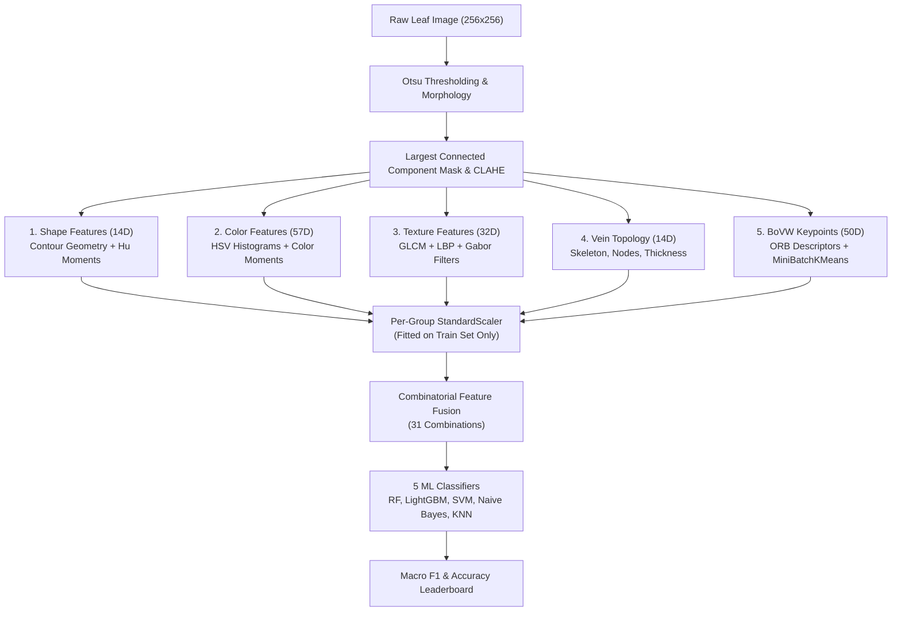

<div align="center">

# 🌿 Indian Medicinal Leaves Classification Benchmark

### An Empirical Multi-Feature Computer Vision & Machine Learning Benchmark

[](https://www.python.org/)
[](https://opencv.org/)
[](https://scikit-learn.org/)
[](https://lightgbm.readthedocs.io/)
[](https://www.kaggle.com/datasets/aryashah2k/indian-medicinal-leaves-dataset)
[](https://opensource.org/licenses/MIT)

<p align="center">
  <b>Systematic 155-experiment benchmark evaluating 31 feature combinations across 5 ML classifiers on 80 Indian Medicinal Leaf species (6,900 images).</b>
</p>

[Key Results](#-key-results) •
[Deep Learning Case Study](#-deep-learning-case-study) •
[Pipeline Architecture](#-pipeline-architecture) •
[Feature Extraction](#-feature-extraction-167-dimensions) •
[Installation & Quick Start](#-installation--quick-start) •
[Benchmark Leaderboard](#-benchmark-leaderboard)

</div>

---

## 📌 Overview

Botanical species identification through leaf image analysis poses significant computer vision challenges due to subtle inter-class variations and high intra-class variations in leaf geometry, pigmentation, micro-texture, and venation.

This repository contains two complementary approaches to Indian medicinal leaf classification:

* A **155-run classical computer-vision benchmark** comparing 5 machine learning classifiers across all $2^5 - 1 = 31$ possible non-empty combinations of 5 domain-specific feature extraction families.
* A **GoogLeNet (Inception-v1) transfer-learning case study** implemented in `medicinalplant_DL.ipynb`, with reproducible data splits, two-phase fine-tuning, explainability, and detailed test metrics.

The classical benchmark uses these feature extraction families:

1. 📐 **Shape Geometry & Hu Invariant Moments** (14 dims)
2. 🎨 **HSV Color Histograms & Color Moments** (57 dims)
3. 🔬 **GLCM, LBP, and Gabor Filter Bank Textures** (32 dims)
4. 🍃 **Canny, Skeleton, Vascular Nodes & Edge Topography** (14 dims)
5. 🔍 **ORB Keypoint Bag-of-Visual-Words (BoVW)** (50 dims)

> [!IMPORTANT]
> **Key Finding**: The combination of **`Shape + Color + Texture + Vein`** features trained on an **SVM (RBF Kernel)** achieved the overall highest benchmark performance with **68.48% Accuracy** and **69.19% Macro F1-score** across all 80 leaf classes.

---

## 🏆 Key Results

| Metric | Overall Best Configuration |
| :--- | :--- |
| **Winning Feature Combination** | `shape + color + texture + vein` (117 dimensions) |
| **Winning Classifier** | **Support Vector Machine (RBF Kernel, C=10)** |
| **Accuracy** | **68.48%** (0.6848) |
| **Macro Precision** | **70.92%** (0.7092) |
| **Macro Recall** | **69.16%** (0.6916) |
| **Macro F1-Score** | **69.19%** (0.6919) |
| **Dataset Size** | **6,900 images** across **80 classes** (5,520 train / 1,380 test) |

### 📈 Best Performance by Feature Combination Size (1 to 5 Groups)

| Feature Count | Best Feature Combination | Top Classifier | Dimensions | Accuracy | Macro F1 |
| :---: | :--- | :---: | :---: | :---: | :---: |
| **1 Group** | `color` | Random Forest | 57 | 58.48% | 58.30% |
| **2 Groups** | `color + texture` | SVM | 89 | 67.90% | 68.17% |
| **3 Groups** | `shape + color + texture` | SVM | 103 | 67.25% | 68.43% |
| **4 Groups** | **`shape + color + texture + vein`** 🏆 | **SVM** | **117** | **68.48%** | **69.19%** |
| **5 Groups** | `shape + color + texture + vein + keypoint` | Random Forest | 167 | 64.93% | 65.60% |

---

## 🏗️ Pipeline Architecture



---

## 🔬 Feature Extraction (167 Dimensions)

Feature extraction targets 5 distinct domain properties of leaf imagery:

### 1. 📐 Shape Descriptors (14 Dimensions)
* **Contour Geometry (7 features)**: Area, Perimeter, Aspect Ratio, Solidity ($\frac{\text{Area}}{\text{Hull Area}}$), Circularity ($\frac{4\pi \cdot \text{Area}}{\text{Perimeter}^2}$), Extent, Equivalent Diameter.
* **Hu Invariant Moments (7 features)**: 7 log-scaled, sign-preserving Hu moments derived from central moments for scale, rotation, and translation invariance:
  $$\text{Hu}_{\text{log}} = -\text{sign}(h_i) \cdot \log_{10}(|h_i| + 10^{-30})$$

### 2. 🎨 Color Descriptors (57 Dimensions)
* **HSV Histograms (48 features)**: 16-bin normalized color intensity histograms computed over leaf pixels only across Hue, Saturation, and Value channels ($16 \times 3 = 48$).
* **Color Moments (9 features)**: Mean, Standard Deviation, and Skewness per channel ($H, S, V$).

### 3. 🔬 Texture Descriptors (32 Dimensions)
* **GLCM - Gray-Level Co-occurrence Matrix (6 features)**: Haralick texture properties (Contrast, Dissimilarity, Homogeneity, Energy, Correlation, ASM) averaged across 4 angles ($0^\circ, 45^\circ, 90^\circ, 135^\circ$).
* **LBP - Local Binary Patterns (10 features)**: 10-bin uniform LBP histogram ($P=8, R=1$) capturing local surface micro-patterns.
* **Gabor Filter Bank (16 features)**: Mean and variance responses across 4 orientations ($0, \frac{\pi}{4}, \frac{\pi}{2}, \frac{3\pi}{4}$) and 2 frequencies ($0.1, 0.3$).

### 4. 🍃 Vein & Edge Topography (14 Dimensions)
* **Canny Edge Density**: Ratio of edge pixels to total leaf area.
* **Skeleton Vein Density**: Ratio of skeletonized binary leaf silhouette pixels to total leaf area.
* **Vascular Nodes**: Endpoint count (1 skeleton neighbor) and Branch point count ($\ge 3$ skeleton neighbors).
* **Vein Thickness Profile**: Mean and Standard Deviation of distance transform values sampled along the skeleton line.
* **Edge Orientation Histogram**: 8-bin Sobel gradient direction histogram within the leaf boundary.

### 5. 🔍 Salient Keypoint Bag-of-Visual-Words (50 Dimensions)
* **ORB Descriptors**: Fast ORB keypoint detection (capped at 300 keypoints/image).
* **BoVW Vocabulary**: MiniBatchKMeans ($k=50$) vocabulary built **exclusively on training set descriptors** to prevent data leakage.
* **Visual Word Histograms**: Normalized frequency distribution of assigned visual words per image.

---

## 🧠 Deep Learning Case Study

[`medicinalplant_DL.ipynb`](./medicinalplant_DL.ipynb) trains an ImageNet-pretrained **GoogLeNet / Inception-v1** classifier on the same Indian Medicinal Leaves dataset. The notebook is designed as a complete case study, from dataset inspection through error analysis and saved model artifacts.

### Workflow

1. **Dataset indexing and EDA**: discovers the Kaggle dataset, encodes the 80 folder-based classes, checks class imbalance and image dimensions, and creates a stratified 70/15/15 train/validation/test split.
2. **Pre-processing and augmentation**: resizes images to 224 × 224, applies ImageNet normalization, and uses random crops, horizontal/vertical flips, rotation, and mild color jitter only for training images.
3. **Transfer learning**: replaces GoogLeNet's classifier with `Dropout(0.4) → Linear(1024, 80)`. The model has approximately 5.68 million parameters after the new head is added.
4. **Training and tuning**: compares a frozen-backbone stage with full fine-tuning, uses AdamW, label smoothing, early stopping, checkpoint restoration, and optional eight-configuration hyper-parameter tuning.
5. **Evaluation**: reports accuracy, top-3 accuracy, macro/weighted precision, recall and F1, one-vs-rest macro ROC-AUC, per-class scores, a confusion matrix, a bootstrap confidence interval, and calibration metrics.
6. **Interpretability and diagnosis**: generates Grad-CAM/feature-map visualizations, embedding-space plots, misclassified examples, and the most-confused class pairs.

### Reported notebook results

The following values are from the executed notebook output using the test split of 1,035 images:

| Metric | GoogLeNet result |
| :--- | :---: |
| Test accuracy | **95.85%** |
| 95% bootstrap confidence interval | **94.45%–96.90%** |
| Top-3 accuracy | **99.61%** |
| Macro F1-score | **0.9568** |
| Macro ROC-AUC | **0.9997** |
| Misclassified test images | **43 / 1,035 (4.15%)** |

Fine-tuning improved validation accuracy from **60.68%** with the frozen backbone to **96.62%** after full fine-tuning. The notebook also reports the weakest classes (`Sapota`, `Nerale`, and `Tulsi`) and the most-confused pairs to support the performance discussion.

### Generated artifacts

When run, the notebook writes plots and reports to `/kaggle/working` on Kaggle or `./outputs` locally, including:

* `01_class_distribution.png`, `02_sample_images.png`, and `03_augmentation.png`
* training curves and hyper-parameter effect plots
* confusion matrix, ROC/calibration, Grad-CAM, feature-map, embedding, and error-analysis figures
* `googlenet_final_model.pth` and `googlenet_results.csv`

> [!NOTE]
> The notebook was executed with a GPU and mixed-precision enabled. CPU execution is supported by the code but will be substantially slower; set `RUN_TUNING = False` to skip the optional tuning sweep.

---

## 💡 Technical Insights & Discussion

> [!NOTE]
> **Color & Texture Synergy**: Standalone `color` achieves **58.30% F1** and `texture` achieves **49.32% F1**. Fusing both boosts the Macro F1 score dramatically to **68.17%**, showing that leaf color distribution and micro-texture are strongly complementary.

> [!TIP]
> **Optimal Feature Fusion**: Adding `shape` and `vein` features to `color + texture` yields the peak benchmark score of **69.19% Macro F1**. Vascular node counts and contour geometry provide critical structural boundaries that distinguish leaves with similar coloration.

> [!WARNING]
> **Keypoint Quantization Effect**: Adding ORB Bag-of-Visual-Words features slightly reduced peak accuracy (from 68.48% down to 64.93%). Quantizing local keypoints into 50 visual words introduced high-frequency noise relative to dense global color/texture descriptors on unaligned leaves.

---

## 💻 Installation & Quick Start

### Prerequisites
* Python $\ge 3.8$
* OpenCV, Scikit-Image, Scikit-Learn, LightGBM, SciPy, Pandas, NumPy

### 1. Clone Repository & Install Dependencies
```bash
git clone https://github.com/your-username/indian-medicinal-leaves-benchmark.git
cd indian-medicinal-leaves-benchmark
pip install -r requirements.txt
```

### 2. Download Dataset
Download the **Indian Medicinal Leaves Image Datasets** from [Kaggle](https://www.kaggle.com/datasets/aryashah2k/indian-medicinal-leaves-dataset) and place the dataset folder in your workspace.

### 3. Run Benchmark Notebook
Launch Jupyter and execute `cv-final.ipynb`:
```bash
jupyter notebook cv-final.ipynb
```

> [!NOTE]
> Feature extraction automatically utilizes Python `multiprocessing.Pool` across all available CPU cores.

### 4. Run the Deep Learning Notebook

The deep-learning notebook requires PyTorch and torchvision in addition to the packages in `requirements.txt`:

```bash
pip install torch torchvision
jupyter notebook medicinalplant_DL.ipynb
```

For Kaggle, attach the `aryashah2k/indian-medicinal-leaves-dataset` dataset and select a GPU accelerator before running the notebook. The notebook automatically searches the standard Kaggle dataset paths; update `DATASET_ROOT` in the setup cell if the dataset is mounted elsewhere.

---

## 📊 Benchmark Leaderboard (Top 10 Configurations)

| Rank | Feature Combination | Classifier | Dimensions | Accuracy | Precision | Recall | Macro F1 |
| :---: | :--- | :---: | :---: | :---: | :---: | :---: | :---: |
| 🥇 **1** | **`shape+color+texture+vein`** | **SVM** | **117** | **0.6848** | **0.7092** | **0.6916** | **0.6919** |
| 🥈 **2** | `shape+color+texture` | SVM | 103 | 0.6725 | 0.7001 | 0.6835 | 0.6843 |
| 🥉 **3** | `color+texture+vein` | SVM | 103 | 0.6768 | 0.6965 | 0.6833 | 0.6825 |
| **4** | `color+texture` | SVM | 89 | 0.6790 | 0.6964 | 0.6830 | 0.6817 |
| **5** | `color+texture+vein` | Random Forest | 103 | 0.6652 | 0.7156 | 0.6727 | 0.6792 |
| **6** | `shape+color+texture` | Random Forest | 103 | 0.6652 | 0.7103 | 0.6754 | 0.6785 |
| **7** | `shape+color+texture+vein` | Random Forest | 117 | 0.6674 | 0.7173 | 0.6715 | 0.6774 |
| **8** | `color+texture` | Random Forest | 89 | 0.6659 | 0.7074 | 0.6677 | 0.6742 |
| **9** | `color+texture+vein+keypoint` | Random Forest | 153 | 0.6464 | 0.7152 | 0.6500 | 0.6588 |
| **10** | `color+texture+keypoint` | Random Forest | 139 | 0.6435 | 0.7036 | 0.6520 | 0.6576 |

---

## 📁 Repository Structure

```
.
├── cv-final.ipynb             # Complete Jupyter Notebook with code, logs & reports
├── medicinalplant_DL.ipynb    # GoogLeNet transfer-learning case study
├── README.md                  # Comprehensive GitHub repository documentation
├── requirements.txt           # Python dependency requirements
├── all_features_raw.csv       # Saved 169-column feature matrix (6,900 x 169)
├── all_combo_results.csv      # Complete metrics log for all 155 benchmark runs
└── leaderboard_sorted.csv     # Ranked leaderboard sorted by Macro F1-score
```
